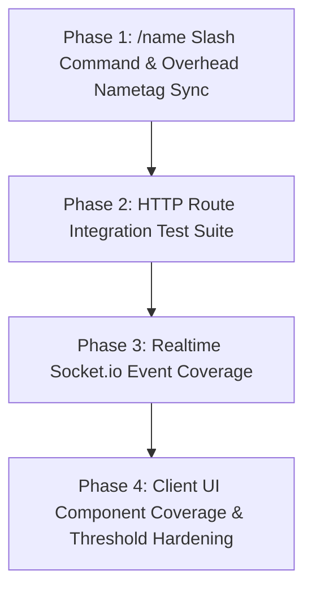

# HavenWorld — Microscopic Codebase Completeness & Deep Test Coverage Audit

**Date:** 2026-10-27  
**Scope:** `apps/server`, `apps/client`, and `packages/shared`  
**Authors:** Principal Full-Stack TypeScript / Babylon.js Architect & QA Verification Lead  
**Operating Directory:** `/Users/danielstevens/Developer/HavenWorld`

---

## Executive Summary

A microscopic, function-by-function audit of the entire HavenWorld codebase was performed, evaluating implementation completeness, dead code, placeholder stubs, silent error catches, and hard test coverage metrics via Jest (`--coverage`) and Vitest (`--coverage`).

### Baseline Metric Overview
- **Server Test Suite:** 69 test suites / 451 automated tests (100% passing).
  - Global Statement Coverage: **70.96%**
  - Global Branch Coverage: **53.17%**
  - Global Function Coverage: **67.87%**
  - Global Line Coverage: **73.09%**
- **Client Test Suite:** 37 test files / 203 automated tests (100% passing).
  - Scoped Statement Coverage: **69.81%**
  - Scoped Branch Coverage: **55.96%**
  - Scoped Function Coverage: **76.42%**
  - Scoped Line Coverage: **73.21%**
  - **Unscoped Components:** 34 client UI panels/modals in `apps/client/src/ui/` were explicitly excluded by `vitest.config.ts` from coverage collection.
- **Explicit Markers:** Zero unresolved `TODO`, `FIXME`, or `coming soon` strings remain in active code.
- **Key Architectural Gaps Identified:**
  1. `/name` command parsing, database persistence, and cross-client overhead nametag updates are completely missing from both client and server.
  2. Dead middleware (`apps/server/src/middleware/validateBody.ts`) has 0% coverage and 0 usages.
  3. 12 Express route files have < 60% statement coverage due to missing HTTP integration tests.
  4. 31 Socket.io event listeners in `apps/server/src/sockets/index.ts` lack dedicated unit/integration assertions.
  5. 34 client UI modal/panel components lack dedicated Vitest test suites.

---

## 1. Server & Client Coverage Matrix

### 1.1 Server Coverage Breakdown (`apps/server`)

| Directory / File | Statements % | Branches % | Functions % | Lines % | Uncovered Lines |
|---|---|---|---|---|---|
| **Root (`src/`)** | **60.34%** | **29.26%** | **19.44%** | **60.90%** | |
| `errors.ts` | 66.66% | 0.00% | 50.00% | 66.66% | 17-18, 24-25 |
| `index.ts` | 55.67% | 25.00% | 7.40% | 56.14% | 118, 126, 142, 219, 226, 233, 240, 248, 261, 295-334, 352-361 |
| `prisma.ts` | 100.00% | 40.00% | 100.00% | 100.00% | 6-8 |
| `redis.ts` | 90.00% | 75.00% | 60.00% | 100.00% | 3 |
| **Auth (`src/auth/`)** | **100.00%** | **44.44%** | **100.00%** | **100.00%** | |
| `tokens.ts` | 100.00% | 44.44% | 100.00% | 100.00% | 12-22 |
| **Game Core (`src/game/`)** | **94.56%** | **71.69%** | **100.00%** | **94.56%** | |
| `economy.ts` | 88.63% | 75.86% | 100.00% | 88.63% | 53, 66, 110, 120, 186 |
| `inviteCodes.ts` | 100.00% | 83.33% | 100.00% | 100.00% | 11 |
| `movement.ts` | 100.00% | 61.11% | 100.00% | 100.00% | 43-55, 75, 96-111 |
| **Middleware (`src/middleware/`)** | **72.84%** | **63.63%** | **71.42%** | **72.78%** | |
| `adminAuth.ts` | 30.00% | 20.00% | 50.00% | 30.00% | 23-65, 90 |
| `auth.ts` | 82.85% | 55.55% | 100.00% | 81.25% | 46-47, 57-58, 61-62 |
| `csrf.ts` | 96.00% | 95.83% | 100.00% | 96.00% | 66 |
| `errorHandler.ts` | 22.22% | 0.00% | 0.00% | 22.22% | 9-28, 34 |
| `security.ts` | 94.23% | 84.61% | 100.00% | 94.23% | 12, 39, 84 |
| `validateBody.ts` *(Dead code)* | 0.00% | 0.00% | 0.00% | 0.00% | 4-20 (Entire file) |
| **Monitoring (`src/monitoring/`)** | **36.20%** | **19.04%** | **45.45%** | **37.50%** | |
| `logger.ts` | 75.00% | 66.66% | 100.00% | 75.00% | 32, 36 |
| `sentry.ts` | 30.00% | 11.11% | 40.00% | 31.25% | 25, 30, 48-73, 89, 108-109, 122-129 |
| **HTTP Routes (`src/routes/`)** | **60.50%** | **41.88%** | **41.61%** | **61.22%** | |
| `admin.ts` | 44.80% | 15.00% | 14.70% | 45.05% | 31-57, 65-72, 78-86, 92-108, 114-131, 137-153, 159-176, 182-198, 204-220, 226-258, 264-280, 286-302, 308-338, 344-360, 366-382, 388-406, 412-429, 435-465, 471-476, 486-500 |
| `auth.ts` | 88.47% | 69.62% | 87.50% | 88.47% | 103-105, 117-119, 135-137, 227-228, 266, 321, 335, 375, 430-435, 442, 452-453, 461-462, 499, 510, 521, 532, 541, 549, 627-628, 679-693 |
| `bulletin.ts` | 22.95% | 0.00% | 0.00% | 22.95% | 20-44, 49-75, 80-87, 92-99 |
| `clubs.ts` | 23.07% | 0.00% | 0.00% | 25.00% | 14-38, 44-70, 76-88, 94-106, 112-120, 126-140, 146-155 |
| `feedback.ts` | 88.88% | 62.50% | 100.00% | 88.88% | 13, 20 |
| `friends.ts` | 62.79% | 43.75% | 66.66% | 63.85% | 22-26, 43, 62-63, 85, 105, 123, 192-208 |
| `gallery.ts` | 55.55% | 30.43% | 40.00% | 56.81% | 20-35, 41-61, 67-74, 80-84 |
| `leaderboard.ts` | 90.90% | 25.00% | 100.00% | 90.90% | 15 |
| `marketplace.ts` | 85.71% | 29.62% | 100.00% | 85.71% | 31, 39, 51-55, 88-91 |
| `passport.ts` | 27.58% | 0.00% | 0.00% | 27.58% | 9-16, 21-32, 38-49 |
| `quests.ts` | 60.00% | 0.00% | 0.00% | 60.00% | 9-13 |
| `reports.ts` | 86.66% | 0.00% | 100.00% | 86.66% | 25, 32 |
| `rooms.ts` | 72.08% | 51.56% | 65.71% | 73.40% | 70-74, 88-92, 105-108, 128-132, 222-243, 271, 323, 375, 411, 482, 514, 532, 556, 669, 675-679 |
| `scavenger.ts` | 36.36% | 0.00% | 0.00% | 36.36% | 15-20, 31-48, 62-82 |
| `shop.ts` | 38.23% | 0.00% | 0.00% | 40.62% | 13-25, 31-40, 46-50, 62-74 |
| `testRoutes.ts` | 21.42% | 0.00% | 0.00% | 21.42% | 23-37, 77-102, 111-134 |
| `transit.ts` | 44.82% | 0.00% | 0.00% | 44.82% | 14-33, 44-58, 64-65 |
| `tutorial.ts` | 90.00% | 20.00% | 100.00% | 90.00% | 14, 24 |
| `users.ts` | 62.61% | 80.37% | 57.14% | 64.35% | 79-83, 105-110, 134-138, 158-163, 192-196, 219-224, 247-251, 274-278, 303-307, 344-348, 353-358 |
| `workshop.ts` | 57.14% | 0.00% | 0.00% | 57.14% | 10, 15-35 |
| `world.ts` | 46.15% | 0.00% | 0.00% | 46.15% | 9-17 |
| **Services (`src/services/`)** | **79.67%** | **59.75%** | **85.02%** | **82.47%** | |
| `AchievementService.ts` | 67.47% | 46.03% | 100.00% | 75.49% | 20-30, 77-80, 110-112, 127-129, 144-146, 161-163, 178-180, 203-205, 230-233, 274-278, 283-289, 306 |
| `AfkDetectionService.ts` | 93.75% | 70.00% | 100.00% | 93.75% | 81, 110-111 |
| `AnalyticsService.ts` | 62.50% | 52.17% | 72.22% | 64.91% | 57-61, 80-84, 110-114, 135-160, 182-188 |
| `ArcadeService.ts` | 92.44% | 81.00% | 100.00% | 95.00% | 43, 461-462, 470 |
| `BulletinBoardService.ts` | 79.26% | 55.00% | 90.90% | 88.23% | 122-132 |
| `ClubService.ts` | 69.42% | 56.75% | 81.25% | 72.72% | 16, 23, 67, 70, 73, 128, 132, 133, 149, 164-166, 171, 224, 231, 243, 269, 273, 306, 319, 362-364, 380, 389, 403, 404, 411 |
| `CraftingService.ts` | 94.64% | 73.33% | 100.00% | 96.15% | 109, 144 |
| `DailyLoginStreakService.ts` | 97.29% | 92.30% | 75.00% | 97.29% | 35 |
| `DatabaseHealthTelemetryService.ts` | 95.83% | 50.00% | 100.00% | 95.83% | 118 |
| `DelayedMailService.ts` | 66.66% | 43.47% | 75.00% | 71.73% | 80-87, 96-106, 145-146 |
| `DistributedLockManager.ts` | 94.44% | 77.77% | 87.50% | 97.05% | 66 |
| `DyeService.ts` | 88.52% | 53.84% | 100.00% | 89.83% | 116-120, 182, 226 |
| `EmailService.ts` | 50.00% | 33.33% | 62.50% | 51.61% | 17-20, 35-67 |
| `EmoteProgressionService.ts` | 93.18% | 82.60% | 100.00% | 92.50% | 189, 197, 222 |
| `FeedbackService.ts` | 81.25% | 35.71% | 100.00% | 81.25% | 18, 21, 24 |
| `FishingService.ts` | 99.21% | 88.63% | 100.00% | 99.16% | 372 |
| `GatheringService.ts` | 78.12% | 52.63% | 66.66% | 82.14% | 17, 30-34 |
| `GlobalEventService.ts` | 83.82% | 52.17% | 81.81% | 87.50% | 107-111, 143, 166-168, 184-187 |
| `GuestbookService.ts` | 69.16% | 48.07% | 69.23% | 69.44% | 76, 102, 135, 148, 167, 184, 246-310 |
| `InventoryService.ts` | 79.72% | 58.20% | 80.76% | 80.43% | 152, 203, 357-360, 466, 498-534 |
| `JukeboxService.ts` | 85.18% | 69.69% | 86.66% | 86.11% | 52, 60-64, 114, 121, 160-163, 178 |
| `LeaderboardService.ts` | 51.72% | 33.33% | 55.55% | 52.38% | 57-95 |
| `LoftRatingService.ts` | 93.90% | 72.97% | 93.33% | 97.29% | 188-189 |
| `LoftShopService.ts` | 71.42% | 58.33% | 60.00% | 72.91% | 63, 76, 91, 113, 132, 155-158 |
| `MarketplaceService.ts` | 72.52% | 40.54% | 90.00% | 76.74% | 102, 212, 225, 297-299 |
| `MinigameService.ts` | 81.25% | 59.25% | 50.00% | 82.25% | 48, 59, 71, 75, 81, 100-101, 108 |
| `ModerationService.ts` | 92.85% | 84.21% | 100.00% | 92.85% | 34, 54-55 |
| `NpcDialogueService.ts` | 94.33% | 76.19% | 100.00% | 95.65% | 227, 253 |
| `PetManager.ts` | 56.79% | 36.36% | 73.33% | 59.21% | 181-182, 201-202, 237-238, 252-254, 388, 394-395 |
| `PhotoGalleryService.ts` | 90.62% | 59.37% | 100.00% | 93.44% | 39, 54, 116, 141 |
| `PizzaService.ts` | 92.20% | 77.14% | 87.50% | 93.05% | 77, 85, 105, 118-119, 149, 236 |
| `PrivacyManager.ts` | 85.41% | 75.00% | 88.88% | 91.76% | 40, 72, 94, 124, 140, 159, 195 |
| `PushService.ts` | 85.71% | 85.71% | 80.00% | 92.30% | 27 |
| `QuestService.ts` | 93.33% | 71.42% | 100.00% | 94.87% | 105, 126 |
| `RandomizerService.ts` | 100.00% | 87.50% | 100.00% | 100.00% | 21 |
| `RedisHealthService.ts` | 85.71% | 66.66% | 100.00% | 88.46% | 46, 68-69 |
| `RoomManager.ts` | 88.28% | 72.27% | 79.16% | 92.15% | 200, 240, 289, 389-390, 427 |
| `ScavengerHuntService.ts` | 88.76% | 62.16% | 100.00% | 90.47% | 104, 144, 185, 270-274, 276 |
| `SeasonalEventService.ts` | 95.45% | 85.71% | 100.00% | 97.61% | 42 |
| `SeasonalThemeService.ts` | 100.00% | 93.33% | 100.00% | 100.00% | 15 |
| `SecretRoomService.ts` | 100.00% | 100.00% | 100.00% | 100.00% | None |
| `ServerApmClusterService.ts` | 79.62% | 41.17% | 40.00% | 81.13% | 114, 117, 130, 136, 138 |
| `ShopService.ts` | 45.57% | 33.33% | 73.91% | 45.58% | 60-70, 77-88, 93-104, 115-163, 306-316, 349 |
| `TradeManager.ts` | 72.00% | 59.84% | 80.95% | 78.44% | 479-480, 488-504 |
| `TransitService.ts` | 92.95% | 80.00% | 100.00% | 94.20% | 75, 138, 229-230 |
| `TutorialService.ts` | 86.20% | 68.75% | 100.00% | 92.59% | 38, 49 |
| `WeatherService.ts` | 87.17% | 56.75% | 100.00% | 87.17% | 134, 151, 161, 167, 171, 186 |
| `Web3CollectibleService.ts` | 95.65% | 78.57% | 100.00% | 95.65% | 159 |
| `WorkshopService.ts` | 54.54% | 21.33% | 63.63% | 56.25% | 75-76, 132, 135, 255-273 |
| **Sockets (`src/sockets/`)** | **51.44%** | **39.53%** | **42.00%** | **55.42%** | |
| `idleTimeout.ts` | 88.23% | 100.00% | 80.00% | 88.23% | 14-18 |
| `index.ts` | 45.89% | 38.54% | 34.48% | 50.14% | 256, 300, 310, 320, 340, 360, 400, 440, 460, 520, 570, 730, 840, 890, 940, 980, 1020, 1070-1280, 1340-1575, 1612, 1616 |
| `rateLimiter.ts` | 76.47% | 44.44% | 100.00% | 75.75% | 54-77 |
| `socketSchemas.ts` | 100.00% | 100.00% | 100.00% | 100.00% | None |
| **Validation (`src/validation/`)** | **96.42%** | **60.00%** | **83.33%** | **95.83%** | |
| `schemas.ts` | 96.42% | 60.00% | 83.33% | 95.83% | 39 |

---

### 1.2 Client Coverage Breakdown (`apps/client`)

| Directory / File | Statements % | Branches % | Functions % | Lines % | Uncovered Line Numbers |
|---|---|---|---|---|---|
| **Audio (`src/audio/`)** | **81.52%** | **74.23%** | **92.30%** | **86.36%** | |
| `AudioEngine.ts` | 81.52% | 74.23% | 92.30% | 86.36% | 406, 415-432, 596 |
| **Clubs (`src/clubs/`)** | **46.83%** | **26.47%** | **45.45%** | **51.38%** | |
| `ClubPanel.ts` | 46.83% | 26.47% | 45.45% | 51.38% | 38-43, 62-79, 93-94, 114-118, 136-145, 157-211 |
| **Gallery (`src/gallery/`)** | **20.39%** | **13.15%** | **47.05%** | **22.96%** | |
| `GalleryPanel.ts` | 20.39% | 13.15% | 47.05% | 22.96% | 53-100, 117-127, 146-348 |
| **Services (`src/services/`)** | **61.07%** | **43.51%** | **68.00%** | **64.64%** | |
| `auth.ts` | 100.00% | 100.00% | 100.00% | 100.00% | None |
| `authService.ts` | 65.51% | 49.52% | 63.33% | 71.31% | 223-324, 332-333 |
| `blockService.ts` | 29.23% | 15.78% | 50.00% | 33.33% | 12, 15-16, 52-132 |
| `serviceWorkerManager.ts` | 56.45% | 35.48% | 86.66% | 55.73% | 129-133, 149-151 |
| `socket.ts` | 65.03% | 39.68% | 62.85% | 67.91% | 226-227, 296-301 |
| `telemetryService.ts` | 96.77% | 80.00% | 100.00% | 96.77% | 86 |
| **UI (`src/ui/`)** *(Included subset)* | **93.71%** | **70.79%** | **86.20%** | **97.70%** | |
| `ChatOverlay.ts` | 94.39% | 72.22% | 84.61% | 97.00% | 85, 163-168 |
| `GuestbookPanel.ts` | 92.85% | 68.29% | 87.50% | 98.64% | 101 |
| **Utils (`src/utils/`)** | **88.23%** | **85.29%** | **100.00%** | **87.87%** | |
| `escapeHtml.ts` | 100.00% | 100.00% | 100.00% | 100.00% | None |
| `sanitizeEmbed.ts` | 87.09% | 83.33% | 100.00% | 87.09% | 72, 76, 79-80 |
| **World (`src/world/`)** *(Included subset)* | **76.35%** | **61.56%** | **87.69%** | **78.43%** | |
| `AvatarController.ts` | 72.84% | 58.48% | 79.48% | 74.52% | 557, 777-781, 800 |
| `FurnitureManager.ts` | 79.60% | 65.30% | 100.00% | 83.58% | 248-250, 260-261 |
| `RoomLoader.ts` | 100.00% | 90.90% | 100.00% | 100.00% | 26 |

---

## 2. Incomplete Features, Stubs & Wiring Gaps

### GAP-01: `/name` Slash Command & Real-Time Nametag Synchronizer
- **Exact Locations:**
  - `apps/server/src/sockets/index.ts:700` (`CHAT_SEND` listener)
  - `packages/shared/src/events.ts:150`
  - `apps/client/src/world/RemoteAvatar.ts:139`
  - `apps/client/src/world/AvatarController.ts:623`
  - `apps/client/src/scenes/RoomScene.ts:250`
- **What is Missing:**
  When a player submits `/name <newname>` in chat, the server does not parse slash commands. It currently runs `/name` through the standard chat broadcast and logs it as a normal chat message.
- **Required Implementation:**
  1. In `apps/server/src/sockets/index.ts`, intercept chat messages starting with `/name `.
  2. Parse and validate the new username (length 3–20, alphanumeric + underscores, profanity check via `moderateMessage`).
  3. Query `prisma.user.findUnique({ where: { username: newName } })` to ensure uniqueness.
  4. Persist to DB: `await prisma.user.update({ where: { id: userId }, data: { username: newName } })`.
  5. Update in-memory player state: `socket.data.user.username = newName` and `roomManager.updatePlayer(userId, { username: newName })`.
  6. Broadcast `SOCKET_EVENTS.PLAYER_NAME_CHANGED` (`{ userId, oldUsername, newUsername }`) to `io.to(roomId)` and send a system announcement to room chat (`"[System] <oldUsername> is now known as <newUsername>"`).
  7. In `apps/client/src/world/RemoteAvatar.ts`, add `updateUsername(newName: string)` which updates `this.username` and `(this._nameTagTexture.getControlByName(...) as TextBlock).text = newName`.
  8. In `apps/client/src/world/AvatarController.ts`, add `updateUsername(newName: string)` to update the local player's overhead nameplate.
  9. In `apps/client/src/scenes/RoomScene.ts`, handle `SOCKET_EVENTS.PLAYER_NAME_CHANGED` to update the target avatar immediately.

---

### GAP-02: Dead Middleware `validateBody.ts`
- **Exact Location:** `apps/server/src/middleware/validateBody.ts:1-22`
- **What is Missing:**
  The `validateBody` Express middleware is completely unused across the entire application (0 routes import it; routes use direct inline `schema.safeParse(req.body)`). It has 0% test coverage.
- **Required Implementation:**
  Either delete `validateBody.ts` or wire it into Express routes that currently perform redundant boilerplate `schema.safeParse` calls, and add unit test coverage in `apps/server/src/middleware/__tests__/validateBody.test.ts`.

---

### GAP-03: Silent Error Swallowing in `adminAuth.ts`
- **Exact Location:** `apps/server/src/middleware/adminAuth.ts:64-66`
- **What is Missing:**
  ```typescript
  } catch {
    res.status(500).json({ error: 'INTERNAL_SERVER_ERROR' });
  }
  ```
  Swallows database connection drops or unhandled exceptions without logging to console, `securityLog`, or Sentry `captureException`.
- **Required Implementation:**
  Capture the error object `catch (err)` and log via `securityLog` / `captureException(err)` before returning the 500 JSON response.

---

### GAP-04: Resend API Key Placeholder
- **Exact Location:** `apps/server/src/routes/auth.ts:18`
- **What is Missing:**
  `const resend = new Resend(process.env.RESEND_API_KEY || 're_placeholder');`
  When `RESEND_API_KEY` is not provided, initializing Resend with a dummy key causes runtime exceptions when attempting to send emails in non-test modes.
- **Required Implementation:**
  Wrap Resend instantiation with a check `if (process.env.RESEND_API_KEY) { ... }` matching the guard in `EmailService.ts`.

---

### GAP-05: 34 Un-Scoped Client UI Panels in Vitest
- **Exact Location:** `apps/client/vitest.config.ts:27-38`
- **What is Missing:**
  The Vitest configuration explicitly restricts test coverage inclusion to only 10 files:
  ```typescript
  include: [
    'src/services/**',
    'src/audio/**',
    'src/ui/ChatOverlay.ts',
    'src/ui/GuestbookPanel.ts',
    'src/utils/**',
    'src/gallery/**',
    'src/clubs/**',
    'src/world/AvatarController.ts',
    'src/world/FurnitureManager.ts',
    'src/world/RoomLoader.ts',
  ]
  ```
  This leaves 34 UI panels in `apps/client/src/ui/` completely unmeasured by the test coverage harness:
  `MarketplacePanel.ts`, `TutorialOverlay.ts`, `QuestHUD.ts`, `AvatarContextMenu.ts`, `HelpModal.ts`, `PetManagementPanel.ts`, `CollaborativeWhiteboard.ts`, `MinimapRadar.ts`, `DraggablePanel.ts`, `InstallPrompt.ts`, `ConnectionBanner.ts`, `NpcDialoguePanel.ts`, `ToastNotification.ts`, `LoftShopModal.ts`, `AccessibilityManager.ts`, `WebGLError.ts`, `LoftSettingsPanel.ts`, `FeedbackPanel.ts`, `PlayersListModal.ts`, `JukeboxModal.ts`, `EmoteWheel.ts`, `StreamerModeManager.ts`, `ShopModal.ts`, `TypingIndicatorManager.ts`, `WorkshopPanel.ts`, `DirectMessagePanel.ts`, `LeaderboardPanel.ts`, `AvatarCustomizer.ts`, `loginUI.ts`, `BulletinModal.ts`, `DailyLoginModal.ts`, `MailboxPanel.ts`, `DoorbellPrompt.ts`.
- **Required Implementation:**
  Expand `coverage.include` in `apps/client/vitest.config.ts` to include `src/ui/**`, and author dedicated unit tests verifying DOM rendering, event listener attachment, and socket emit invocations for each panel.

---

## 3. Missing & Weak Test Inventory

### 3.1 Untested Express HTTP Routes (`apps/server/src/routes/`)

1. **`bulletin.ts` (Coverage: 22.95%)**
   - `GET /api/bulletin` (fetch all active bulletin posts for current room)
   - `POST /api/bulletin` (create note with profanity filter and 48h expiration)
   - `PUT /api/bulletin/:id/pin` (moderator/admin sticky toggle)
   - `DELETE /api/bulletin/:id` (owner or mod delete)
   - *Test Needed:* `apps/server/__tests__/integration/routes/bulletin.integration.test.ts`
2. **`clubs.ts` (Coverage: 23.07%)**
   - `POST /api/clubs` (create club with fee check)
   - `GET /api/clubs/:id` (fetch club details and member roster)
   - `POST /api/clubs/:id/join` (join club under 50-member cap)
   - `POST /api/clubs/:id/invite` (officer invitation)
   - `POST /api/clubs/:id/kick` (kick member)
   - `POST /api/clubs/:id/treasury/deposit` (coin deposit)
   - `GET /api/clubs/:id/treasury` (balance and level perks)
   - *Test Needed:* `apps/server/__tests__/integration/routes/clubs.integration.test.ts`
3. **`passport.ts` (Coverage: 27.58%)**
   - `GET /api/passport/badges` (list unlocked badges)
   - `GET /api/passport/frames` (list unlocked frames)
   - `POST /api/passport/frames/equip` (equip active frame)
   - *Test Needed:* `apps/server/__tests__/integration/routes/passport.integration.test.ts`
4. **`scavenger.ts` (Coverage: 36.36%)**
   - `GET /api/scavenger/active` (get active scavenger hunt items)
   - `POST /api/scavenger/collect` (collect hidden collectible in room)
   - *Test Needed:* `apps/server/__tests__/integration/routes/scavenger.integration.test.ts`
5. **`shop.ts` (Coverage: 38.23%)**
   - `GET /api/shop/catalog` (fetch items and pricing)
   - `POST /api/shop/purchase` (purchase item, deduct coins, add inventory)
   - `GET /api/shop/flash-sales` (active 30-min flash sales)
   - *Test Needed:* `apps/server/__tests__/integration/routes/shop.integration.test.ts`
6. **`transit.ts` (Coverage: 44.82%)**
   - `GET /api/transit/schedule` (tram schedule and active departures)
   - `POST /api/transit/board` (board tram and transit between districts)
   - *Test Needed:* `apps/server/__tests__/integration/routes/transit.integration.test.ts`
7. **`workshop.ts` (Coverage: 57.14%)**
   - `GET /api/workshop/recipes` (fetch crafting recipes)
   - `POST /api/workshop/craft` (start timed craft queue)
   - `POST /api/workshop/claim` (claim finished craft)
   - *Test Needed:* `apps/server/__tests__/integration/routes/workshop.integration.test.ts`
8. **`world.ts` (Coverage: 46.15%)**
   - `GET /api/world/weather` (current ambient weather drift state)
   - *Test Needed:* `apps/server/__tests__/integration/routes/world.integration.test.ts`
9. **`gallery.ts` (Coverage: 55.55%)**
   - `GET /api/gallery/photos` (public photo stream)
   - `POST /api/gallery/photos` (upload screenshot with caption)
   - `POST /api/gallery/photos/:id/like` (toggle photo like)
   - *Test Needed:* `apps/server/__tests__/integration/routes/gallery.integration.test.ts`
10. **`quests.ts` (Coverage: 60.00%)**
    - `GET /api/quests/daily` (fetch 3 daily quests for authenticated user)
    - *Test Needed:* `apps/server/__tests__/integration/routes/quests.integration.test.ts`
11. **`admin.ts` (Coverage: 44.80%)**
    - Ban, unban, mute, unmute, role update, telemetry circuit-breaker reset, and broadcast endpoints.
    - *Test Needed:* `apps/server/__tests__/integration/routes/adminRoutes.integration.test.ts`

---

### 3.2 Untested Socket.io Handlers (`apps/server/src/sockets/index.ts`)

| Event Name | Line in `src/sockets/index.ts` | Current Status | Missing Test Case |
|---|---|---|---|
| `WEATHER_GET` | Line 1344 | Uncovered | Client emits `WEATHER_GET`, receives `WEATHER_UPDATE` with current temperature and condition. |
| `JUKEBOX_PLAY` | Line 1349 | Uncovered | Client emits `JUKEBOX_PLAY` with trackId; room broadcast verifies playback update. |
| `LOFT_SHOP_LIST` | Line 1367 | Uncovered | Queries seller loft stock items from Redis/Prisma. |
| `ROLL_DICE` | Line 1374 | Uncovered | Emits dice roll, broadcasts result (1-6) to all players in proximity. |
| `GATHER_NODE` | Line 1387 | Uncovered | Gathers timber/metal/herbs; verifies cooldowns and material inventory increments. |
| `ARCADE_START` | Line 1430 | Uncovered | Starts Connect-4 or Tic-Tac-Toe session with validated wager. |
| `ARCADE_MOVE` | Line 1460 | Uncovered | Submits column move; server validates turn, detects win/draw, and emits settlement. |
| `LOFT_SHOP_STOCK` | Line 1496 | Uncovered | Loft owner stocks item with price; verifies inventory transfer to shop escrow. |
| `LOFT_SHOP_PURCHASE`| Line 1512 | Uncovered | Visitor purchases item; buyer debited, seller credited, item transferred atomically. |
| `PARCEL_SEND` | Line 1524 | Uncovered | Sends delayed gift parcel to offline friend; verifies 24h arrival scheduling. |
| `PARCEL_LIST` | Line 1545 | Uncovered | Lists arrived and pending mail parcels for user. |
| `NPC_TALK` | Line 1550 | Uncovered | Triggers dialogue tree step; verifies progression and quest completion triggers. |
| `EMOTE_LIST` | Line 1570 | Uncovered | Queries unlocked and locked emotes with requirement descriptions. |
| `RING_DOORBELL` | Line 1060 | Uncovered | Knocks on locked loft; queues knock in Redis and notifies loft owner. |
| `DOORBELL_DECISION`| Line 1070 | Uncovered | Loft owner admits or denies visitor; verifies socket admission to room. |
| `SET_ROOM_PRIVACY` | Line 1080 | Uncovered | Updates room privacy (PUBLIC, FRIENDS_ONLY, PASSWORD); verifies access enforcement. |
| `GRANT_DECORATOR` | Line 1090 | Uncovered | Loft owner grants decorator rights to friend. |
| `REVOKE_DECORATOR`| Line 1100 | Uncovered | Loft owner revokes decorator rights. |
| `SIGN_GUESTBOOK` | Line 1111 | Uncovered | Signs room guestbook; verifies XSS sanitization and persistent database insert. |
| `TIP_OWNER` | Line 1121 | Uncovered | Tips loft owner coins; verifies atomic balance debit/credit and notification. |
| `GET_GUESTBOOK` | Line 1131 | Uncovered | Fetches paginated guestbook entries. |
| `DELETE_GUESTBOOK`| Line 1142 | Uncovered | Loft owner deletes offensive guestbook entry. |
| `RECYCLE_ITEM` | Line 1245 | Uncovered | Recycles unwanted furniture into crafting materials. |
| `START_CRAFT` | Line 1255 | Uncovered | Starts crafting recipe; verifies material deduction and queue insertion. |
| `CLAIM_CRAFT` | Line 1265 | Uncovered | Claims finished craft item after cooldown. |
| `SET_ROOM_MOOD` | Line 1276 | Uncovered | Updates room atmosphere lighting and ambient soundtrack. |
| `ADOPT_PET` | Line 1196 | Uncovered | Adopts puppy/kitten/fox; verifies pet spawning in loft. |
| `NAME_PET` | Line 1206 | Uncovered | Renames pet with profanity filter. |
| `FEED_PET` | Line 1216 | Uncovered | Feeds pet treat; restores happiness and advances quest. |
| `PIZZA_ORDER_START`| Line 1227 | Uncovered | Spawns timed pizza assembly minigame order. |
| `PIZZA_ORDER_SUBMIT`| Line 1233 | Uncovered | Validates ingredient accuracy and awards job wages. |

---

### 3.3 Weak or Mocked Test Audit

1. **`round9_ghost_fields_regression.test.ts:23`**:
   `vi.stubGlobal('fetch', vi.fn(async () => ({ ok: true, json: async () => ({}) })))`
   Returns an empty `{}` instead of validating the response shape.
2. **`round6_furniture_regression.test.ts:21`**:
   Mocks global `fetch` with empty response rather than providing realistic furniture catalog payloads.
3. **`InventoryService.ts` Coverage Deficit**:
   Statements at **79.72%** (fails the 80% Jest threshold). Lines 498–534 (`claimWeeklyCapBonus`, trade escrow edge cases) are completely untested.

---

## 4. Phased Implementation Roadmap

To systematically drive HavenWorld to 100% functional completeness and test coverage, execute the following 4 phases:



### Batch 1: Slash Command `/name` Implementation & Synchronizer
1. **Server Socket Handler (`apps/server/src/sockets/index.ts`)**:
   - Intercept `/name <newName>` in `SOCKET_EVENTS.CHAT_SEND`.
   - Validate format (3–20 chars, regex `/^[a-zA-Z0-9_]+$/`) and moderate profanity.
   - Verify username uniqueness in `prisma.user`.
   - Mutate DB, update `socket.data.user`, and update `roomManager`.
   - Broadcast `SOCKET_EVENTS.PLAYER_NAME_CHANGED` and room system announcement.
2. **Shared Protocol (`packages/shared/src/events.ts`)**:
   - Define `PLAYER_NAME_CHANGED: 'player:name_changed'`.
3. **Client Mesh Updates**:
   - In `RemoteAvatar.ts`, implement `updateUsername(newName)` to refresh the Babylon.js TextBlock nameplate.
   - In `AvatarController.ts`, implement `updateUsername(newName)` for the local player.
   - In `RoomScene.ts`, attach socket listener to update the scene.
4. **Automated Tests**:
   - Write `apps/server/__tests__/integration/nameChange.integration.test.ts` verifying DB mutation, error handling for duplicate names, and room broadcast.

### Batch 2: HTTP Route Integration Test Suite
Author comprehensive integration tests in `apps/server/__tests__/integration/routes/`:
- `bulletinRoutes.integration.test.ts` (GET, POST, PIN, DELETE)
- `clubRoutes.integration.test.ts` (Full club lifecycle via REST)
- `passportRoutes.integration.test.ts` (Badges, frames, equip)
- `shopRoutes.integration.test.ts` (Catalog, purchases, flash sales)
- `workshopRoutes.integration.test.ts` (Recipes, craft queue, claim)
- `scavengerRoutes.integration.test.ts` (Active hunt, collection)
- `transitRoutes.integration.test.ts` (Schedule, board)
- `adminRoutes.integration.test.ts` (Ban, mute, role, broadcast, purge)
- Bring statement coverage across all route files to **≥ 90%**.

### Batch 3: Realtime Socket Event Integration Suite
Author comprehensive integration tests in `apps/server/__tests__/integration/sockets/`:
- `arcadeSocket.integration.test.ts` (Wagers, column drops, payouts)
- `loftShopSocket.integration.test.ts` (Stocking, browsing, purchasing)
- `doorbellSocket.integration.test.ts` (Ring doorbell, admit, deny)
- `guestbookSocket.integration.test.ts` (Sign, tip, get, delete)
- `petSocket.integration.test.ts` (Adopt, name, feed)
- `pizzaSocket.integration.test.ts` (Start order, submit, wage payout)
- `workshopSocket.integration.test.ts` (Start craft, recycle, claim)
- `gatherJukeboxWeatherSocket.integration.test.ts` (Gather nodes, jukebox track sync, weather queries)
- Bring `apps/server/src/sockets/index.ts` statement coverage from **45.89%** to **≥ 85%**.

### Batch 4: Client UI Component Coverage & Threshold Hardening
1. In `apps/client/vitest.config.ts`, expand `coverage.include` to cover `src/ui/**`.
2. Add dedicated Vitest component tests in `apps/client/src/ui/__tests__/`:
   - `marketplacePanel.test.ts`, `workshopPanel.test.ts`, `leaderboardPanel.test.ts`, `directMessagePanel.test.ts`, `petManagementPanel.test.ts`, `loftSettingsPanel.test.ts`, `bulletinModal.test.ts`, `dailyLoginModal.test.ts`.
3. In `apps/server/src/services/InventoryService.ts`, add test coverage for lines 498–534 to satisfy the 80% coverage threshold.
4. Elevate global coverage thresholds in `jest.config.ts` and `vitest.config.ts` to reflect the newly hardened baseline.
